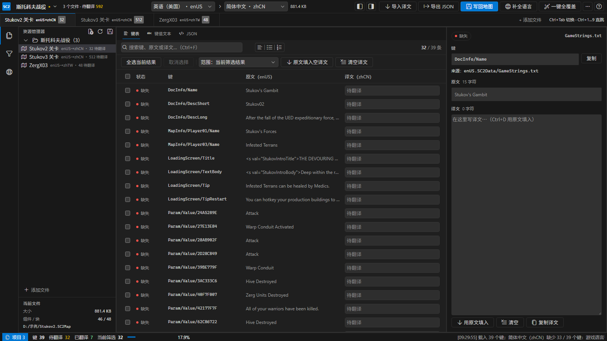

# SC2Translater

**星际争霸 II 地图 / 模组汉化工具** —— 把地图里散落的文本「原始键」提取出来，
填回目标语言目录，让游戏在中文环境下显示文本而不是键路径。

提供两套入口：**CLI**（面向 agent，`--json` 输出机器可读结果）与 **桌面 GUI**（面向普通用户）。

---

## 1. 它解决什么问题

星际争霸 II 的本地化是「键 -> 文本」查表，**键由地图自己携带**。
地图里的每个语言目录 `<locale>.SC2Data` 只有**当前游戏语言**那一份会被加载：

```
地图.SC2Map
├── enUS.SC2Data/LocalizedData/GameStrings.txt     <- 英文作者写在这里
├── enUS.SC2Data/LocalizedData/TriggerStrings.txt
└── (没有 zhCN.SC2Data)
```

游戏语言设为中文时，引擎去 `zhCN.SC2Data` 找键 —— 找不到。
**它不会回退到英文**，而是把键本身当文本渲染出来，于是界面上出现：

```
DocInfo/Name
MapInfo/Player01/Name
Param/Value/0F5D0539
```

这就是「原本英文的键显示成错误的路径」。

### 实测证据（本机真实数据）

| 样本 | 观测 |
| --- | --- |
| `Stukov2.SC2Map`（社区战役，902 KB） | 46 个组件里**只有 enUS**；677 个键在中文环境下 0 覆盖 |
| `kithotsbrutal.SC2Mod` 的 zhCN | `GameStrings.txt` 只有 **40 字节**（1 条键），而 enUS 有 2.4 MB |
| 暴雪官方 `zchar01.SC2Map` 的 zhCN | 48/50 行写成 `中文 /// English 原文`，且非英文目录里**没有** TriggerStrings —— 那是编辑器专用表 |
| 抽样 60 个真实归档 | `28 个没有 zhCN 目录`；语言代码还出现过 enCN / enGB / enSG / enTW / jaJP / zhCH |

---

## 2. 三个动作

```
sc2trans audit   地图.SC2Map                     # 先看每种语言的覆盖率，定位问题
sc2trans extract 地图.SC2Map -o keys.json        # 导出翻译键 + 英文原文
# （翻译 keys.json 里的 target 字段）
sc2trans apply   地图.SC2Map keys.json -o 中文.SC2Map   # 写回目标语言并重新封装
sc2trans seed    地图.SC2Map --target zhCN       # 没有译文时的兜底：先用原文补满
```

**最快见效的是「补全默认语言」**：`fill --locales all` 会用源语言把**所有**没有语言文件的语言一次补上，
游戏切到任何一种语言都不会再露出 `Param/Value/xxxxxxxx`。
之后再把译文填进 JSON / GUI 走 `apply`。

实测（`Stukov2.SC2Map`，原本只有 enUS）：一次补齐 11 种语言、7447 条，
12 种语言覆盖率全部 100%，体积 902 586 → 1 059 752 字节。

---

## 3. 快速开始

### 3.1 CLI（Rust，交付形态）

```powershell
cargo build --release
target/release/sc2trans.exe audit  "D:\Game\BLZ\StarCraft II\Maps\你的地图.SC2Map"
target/release/sc2trans.exe extract "...\你的地图.SC2Map" -o keys.json
target/release/sc2trans.exe apply   "...\你的地图.SC2Map" keys.json -o 汉化.SC2Map
```

命令与参数：

| 命令 | 作用 |
| --- | --- |
| `info <archive>` | 容器概览：格式、组件数、语言目录、HET/BET |
| `list <archive>` | 列出归档里的语言与字符串表 |
| `extract <archive> [-o json]` | 提取翻译键；`--source/--target/--file/--all-locales` |
| `audit <archive>` | 按语言算覆盖率（回答「为什么显示成路径」） |
| `apply <archive> <json> [-o out]` | 写回译文；`--fill-missing/--with-original/--sort/--force` |
| `fill <archive> --locales all` | **补全默认语言**：用源语言填充「没有语言文件」的语言 |
| `seed <archive> [-o out]` | 同 fill，只补当前目标语言 |
| `verify <archive>` | 容器自检 + 字符串表往返回读 |

**给 agent 的约定**：任何子命令加 `--json`（放在前后都行），
stdout 就是一个完整 JSON 对象，进度与告警全部走 stderr，退出码 0/1。

### 3.2 GUI（Tauri 2 + Vue 3）



界面**直接接 VS Code 的官方控件与官方主题**，不是照着仿：

| 来源 | 用在哪 |
| --- | --- |
| [`@vscode-elements/elements`](https://vscode-elements.github.io)（MIT，38 个 Web Components） | 按钮、文本框、下拉、复选框、单选、标签页、`<vscode-tree>` 资源管理器树、右键菜单、折叠面板、进度条、徽标、官方 split-layout 分隔栏 |
| `@vscode/codicons`（微软官方图标字体） | 全部图标 |
| VS Code 官方 **Dark Modern** 主题 | 131 个 `--vscode-*` 色令牌，由 `scripts/gen-vscode-theme.py` 从微软仓库的主题 JSON 生成（各区域各自的底色/边框，不做「一个色糊到底」） |

布局按 VS Code 来：最左活动栏 -> 资源管理器（项目树）-> 编辑器（多标签 + 面包屑）-> 右侧详情，
分隔条用官方的 `<vscode-split-layout>`，栏宽可拖且记在本地。

| 能力 | 说明 |
| --- | --- |
| 键表 | 窗口化渲染（上万条也不卡）、行内直接改译文、状态实时更新 |
| 搜索与过滤 | 按键 / 原文 / 译文搜索；按状态（待翻译、缺失、未翻译、已翻译）与字符串表过滤，每项都带计数 |
| 批量操作 | 全选当前结果、`原文填入空译文`、清空译文；作用范围可选「当前筛选结果 / 全部条目」 |
| 详情面板 | 完整键、来源组件、整段原文、**内联标记清单**（`<n/>`、`%token%` 必须整体保留） |
| 导入 / 导出 | 导出 JSON 交给翻译者；把翻译好的 JSON 导回来按 (字符串表, 键) 合并 |
| **补全语言** | 一张只带 enUS 的地图，一次把**其余全部语言**补上（默认只补缺的键，不覆盖已有译文） |
| **JSON 编辑器** | 内置的 sc2trans.keys.v1 编辑器：就地校验、格式化、按 key 排序，改完「应用到表格」 |
| 一键兜底 | 只用原文补当前目标语言 |
| 密度与键盘 | 紧凑 / 标准 / 舒适三档行高；↑↓ 移动、Ctrl+F 搜索、Ctrl+S 导出、Ctrl+Enter 写回 |
| 拖放 | 把 `.SC2Map` / `.SC2Mod` 直接拖进窗口 |

```powershell
# 开发（浏览器里调 UI，自动进入演示模式）
pnpm -C ui install
pnpm -C ui dev              # http://localhost:5184/ ，加 ?demo=1 直接进工作区

# 打包（custom-protocol 已是默认特性，普通 cargo build 就会内嵌 ui/dist）
pnpm -C ui build
cargo build --release
```

> ⚠️ 桌面壳必须内嵌 `ui/dist`（custom-protocol 特性，**已是默认**）；
> 否则 release 版会去连 devUrl，在没有 dev server 的机器上就是一片空白窗口（已实测）。

### 3.3 Python 调研原型

事实验证与交叉判据都在这一份里，Rust 实现与它做差分测试。

```powershell
cd python
uv sync
uv run sc2trans-py audit "...\地图.SC2Map"
uv run pytest
```

---

## 4. 翻译键 JSON（schema = `sc2trans.keys.v1`）

```json
{
  "schema": "sc2trans.keys.v1",
  "source_locale": "enUS",
  "target_locale": "zhCN",
  "entries": [
    { "key": "DocInfo/Name", "file": "GameStrings.txt",
      "source": "Domination", "target": null,
      "status": "missing", "origin": ["enUS.SC2Data/GameStrings.txt"] }
  ],
  "stats": { "entries": 677, "by_status": { "missing": 677 } },
  "diagnosis": { "severity": "warning", "message": "……" }
}
```

| status | 含义 |
| --- | --- |
| `missing` | 目标语言没有这个键 —— **游戏里会显示成键路径** |
| `identical` | 与原文完全相同（等于没翻） |
| `translated` | 已翻译 |
| `extra` | 只在目标语言里存在 |
| `no-source` | 没有原文 |

翻译者只需要填 `target`。
也可以直接手写扁平 JSON：`{ "DocInfo/Name": "统治" }` —— `apply` 两种都收。

---

## 5. 仓库结构

```
crates/
  sc2mpq/          MPQ 容器读写（SC2 的 208 字节混合头 / HET / BET / 六头部 MD5 摘要）
  sc2trans-core/   领域核心：字符串表、locale 模型、JSON、extract/apply/seed/audit/verify
  sc2trans-cli/    sc2trans 命令行（面向 agent）
src-tauri/         Tauri 2 桌面壳（只做命令转发，业务全在 core）
ui/                Vue 3 + TypeScript + Vite 前端
python/            uv 管理的调研原型 + 对照实现（Rust 与它做差分测试）
docs/research/     实测调研：MPQ 格式规格、SC2 多语言机制
docs/design/       架构与设计文档
testdata/          本地样本与产物（不入库）
```

依赖方向（不可违反）：`sc2mpq` <- `sc2trans-core` <- `sc2trans-cli / src-tauri` <- `ui`。
核心层不得依赖 GUI、不得弹窗。

---

## 6. 怎么验证

```powershell
cargo test                       # 单元 + 真实归档验收（找不到样本自动跳过）
cargo clippy --all-targets       # 应无警告
cd python; uv run pytest          # 28 项
```

验收判据（全部已通过）：

| 判据 | 结果 |
| --- | --- |
| 5 个真实归档的 HET/BET **逐字节重生成** | 通过 |
| 头部 6 个 MD5 摘要全部有效、HET 与经典表查找逐名一致 | 通过 |
| 产物 `dwRawChunkSize == 0`（这是编辑器接受改动的硬条件） | 通过 |
| 改动 1 个组件后，其余 **182 个组件逐字节不变** | 通过 |
| Rust 与 Python 在真实地图上提取结果**逐字段一致**（677/677） | 通过 |
| 两边产出的 zhCN 组件**逐字节相同** | 通过 |
| 产物通过**独立第三方 StormLib** 全量抽取（81/81） | 通过 |
| **银河编辑器打开产物不崩溃**（原件作对照：3 份全部 LOADED） | 通过 |

---

## 7. 已知边界

* **不会自动跑编辑器/游戏验收**。容器层已过 StormLib，但「银河编辑器能打开」这一步需要人工做一次
  （`docs/design/验收清单.md`）。
* `TriggerStrings.txt` 是**编辑器专用**表，缺了不影响玩家看到的文本；`audit` 会把它单独标出来。
* 键里的 8 位十六进制（如 `Param/Value/0F5D0539`）是**编辑器分配的随机 Id**，
  同一段文本在不同地图里键不同 —— 所以回填**必须按键**，不能按值匹配。
* `///` 之后的英文原文由暴雪自己使用；本工具默认**不新增**它（`--with-original` 可开）。
* 归档缺 `(listfile)` 时无法按名字枚举（MPQ 的 HET/BET 只存哈希），工具会直接报错。

---

## 8. 许可

MIT。本工具不分发任何暴雪版权资源。
